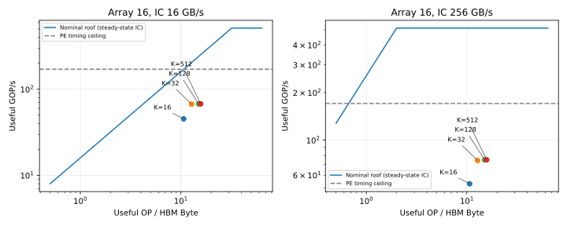
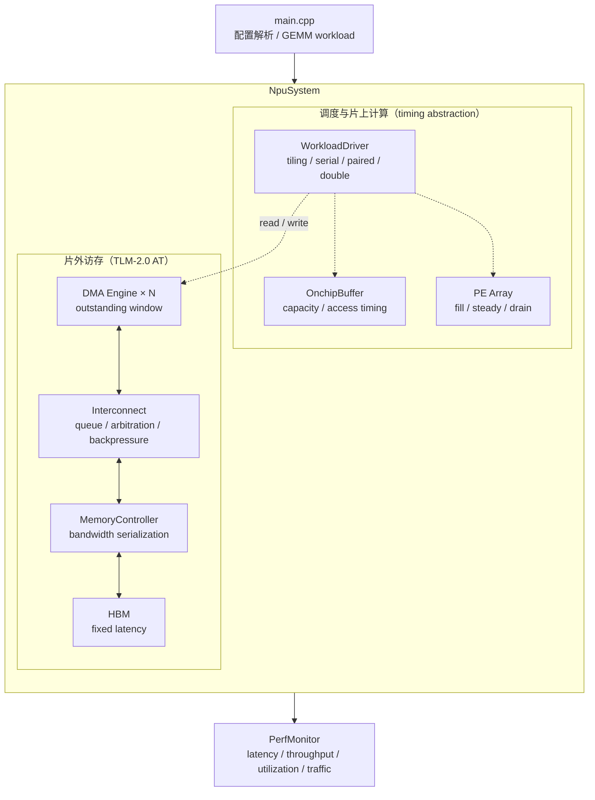
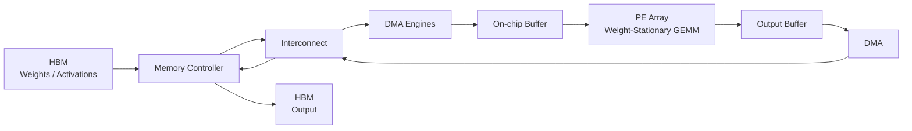
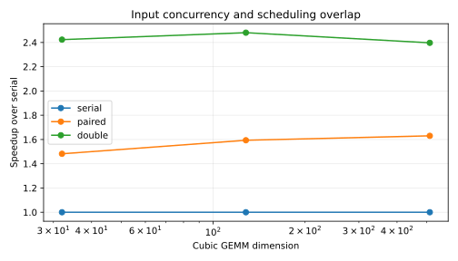
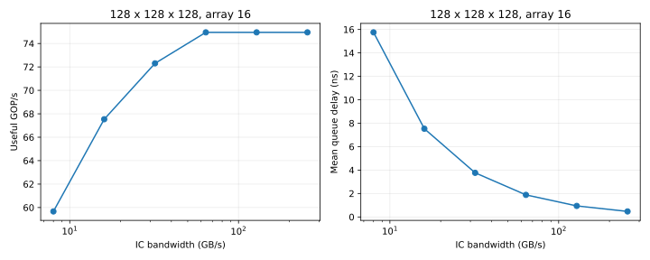
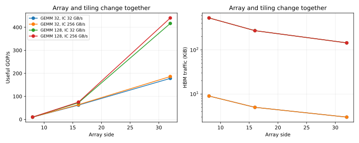
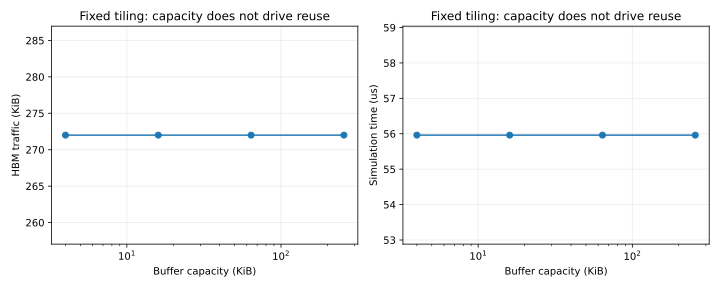

# NPU Performance Model

<p align="center">
  <strong>SystemC-Based NPU Architecture Performance Modeling Framework</strong><br/>
  面向 NPU 架构探索的 SystemC 性能建模框架
</p>

<p align="center">
  <em>从 GEMM workload 出发，研究计算阵列、片上存储、DMA、互连与 HBM 之间的性能关系。</em>
</p>

<p align="center">
  
</p>

---

## 1. 项目简介

**npu-perf-model** 是一个基于 **C++17、SystemC 2.3.x 和 TLM-2.0** 构建的 NPU 架构性能模型。项目以 GEMM 为当前主要 workload，对 NPU 中计算与数据搬运的关键路径进行时序建模，帮助研究不同架构参数和调度策略对性能的影响。

模型覆盖从片上计算到片外存储的主要组件：

- **Compute**：Weight-Stationary 脉动阵列、PE fill/steady/drain 时序。
- **On-chip Memory**：片上 Buffer 容量与访问时延抽象。
- **Data Movement**：多 DMA、outstanding 请求窗口和双缓冲调度。
- **Interconnect**：请求队列、仲裁、转发带宽、背压与竞争。
- **Off-chip Memory**：Memory Controller 带宽串行化和 HBM 固定访问延迟。
- **Analysis**：吞吐、延迟、利用率、访存流量、排队/背压统计、Roofline 定位和参数扫描。

项目的目标不是替代 RTL 仿真或真实芯片测量，而是提供一个**可解释、可配置、便于开展架构敏感性实验的近似周期级性能模型**。

## 2. 核心能力

| 领域 | 当前建模能力 | 可研究的问题 |
|---|---|---|
| 计算阵列 | Weight-Stationary PE Array；fill / steady / drain | 阵列规模、GEMM 分块与计算时序 |
| 片上 Buffer | 容量检查与访问带宽/时延抽象 | Buffer 配置对数据供给的影响 |
| DMA | 多 DMA engine、outstanding 窗口、读写事务 | 并发搬运与请求供应能力 |
| 调度 | serial、paired、double buffering | 输入并发、预取与计算重叠 |
| Interconnect | FIFO / RR / Priority 仲裁、队列、背压、NoC 延迟和带宽 | 多 DMA contention 与仲裁行为 |
| Memory Controller / HBM | 带宽串行化、固定访问延迟、多个 outstanding 请求 | 带宽限制与延迟隐藏 |
| 性能分析 | JSON/CSV 统计、Roofline、参数扫描、独立解析验证 | 瓶颈定位和架构方案比较 |

## 3. 系统架构

模型由两条相互协作的路径组成：

1. **调度与片上计算路径**：Workload Driver 负责 GEMM tiling 和调度，驱动 Buffer 与 PE Array。
2. **片外访存路径**：DMA 请求经 Interconnect、Memory Controller 到达 HBM；响应沿 TLM backward path 返回。



**连线含义：** 访存链路采用 TLM-2.0 AT 四相事务；调度器到片上 Buffer、PE 和 DMA 的虚线表示模型内部的函数/时序驱动关系。图中的双向访存连线表示请求与响应方向，不代表真实数据在模型中被逐字节搬运。

## 4. 数据流与执行过程

当前 GEMM workload 的逻辑执行过程如下：



一次典型执行包含三个阶段：

1. **Load**：DMA 将权重和激活 tile 从 HBM 搬入片上 Buffer。
2. **Compute**：PE Array 按 Weight-Stationary 数据流执行 tile 计算，并对 K 维结果进行累加。
3. **Store**：输出 tile 经 DMA 写回 HBM。

启用双缓冲时，下一 tile 的加载可以与当前 tile 的计算重叠。当前模型记录事务时序和流量，不搬运真实矩阵元素，也不执行真实 MAC 数值计算。

## 5. 建模方法与适用范围

### 5.1 抽象层次

本项目采用 **cycle-approximate / timing-oriented** 方法：

- 计算阵列通过参数化时序模型表示，不是 RTL 级逐周期逻辑仿真。
- DMA、Interconnect、Memory Controller 和 HBM 通过 SystemC TLM-2.0 AT 事务表达关键请求/响应时序。
- 片上 Buffer 采用容量和访问时序抽象，不是完整 SRAM 电路或 bank-level 实现。
- workload 当前以 GEMM 为主，尚不等同于完整 Transformer/NPU 指令级执行模型。

### 5.2 指标口径

模型输出的性能指标用于比较**同一模型假设下**不同 workload 和配置的相对变化。阅读结果时应区分：

- **Latency**：模型估算的 workload 完成时间。
- **Throughput**：模型统计的单位时间运算量。
- **Operational / Arithmetic Intensity**：运算量与片外访存字节数之比；具体运算计数口径应结合报告说明。
- **Utilization**：模型定义的 PE 有效工作比例。
- **Contention metrics**：排队等待、背压 stall、队列满事件及仲裁授予统计。

实验报告采用 **1 MAC = 2 OP** 的计数约定。历史 CSV 字段可能沿用 FLOP 等旧标签，进行跨文件比较时应优先使用 JSON 与实验报告中明确说明的 OP 口径，避免将 MAC、OP 和 FLOP 混为一谈。

### 5.3 当前局限

当前模型**尚未经过真实 NPU 硬件校准**，不能将输出直接视为真实芯片性能承诺。以下因素仍未完整建模：

- 完整 SRAM bank / 多端口竞争及容量驱动的跨 tile 驻留复用；
- HBM bank、channel、row-buffer 和 burst 级细节；
- 完整 NoC 拓扑、路由、多跳链路和虚通道；
- 更完整的并发时序独立 oracle、公平性和持续流量验证；
- 真实 PE 微架构、频率/功耗/热约束及不同数据精度；
- Attention、FFN、KV Cache 等完整 Transformer workload。

## 6. 实验结果

仓库包含 MVP-5 的固定实验集、独立解析验证、参数扫描数据和可复现绘图脚本。当前归档报告覆盖 **62 个固定用例、836 项校验**；这些结果验证的是当前模型实现与其假设的一致性，而不是对真实硬件预测精度的校准。

### 6.1 调度策略对比

512×512×512 GEMM、16×16 阵列的实验中，serial、paired 和 double buffering 三种模式的请求数与流量相同，性能差异来自调度和重叠机制。

| 调度模式 | 模型时间 |
|---|---:|
| serial | 8561.664 μs |
| paired | 5252.096 μs |
| double | 3571.865 μs |

double 相对 serial 的模型加速比约为 **2.397×**。这不是减少访存量带来的收益，而是并发输入与加载/计算重叠带来的收益。

<p align="center">
  
</p>

### 6.2 架构参数敏感性

以下为当前模型在指定实验配置下的结果，不能脱离 workload 和其他参数单独外推：

<p align="center">
  
  <br/>
  <em>Interconnect 带宽扫描</em>
</p>

<p align="center">
  
  <br/>
  <em>阵列规模、分块与访存流量的联合影响</em>
</p>

<p align="center">
  
  <br/>
  <em>当前 Buffer 容量实验基线</em>
</p>

### 6.3 Roofline 分析

<p align="center">
  
</p>

Roofline 图用于将 workload 的运算强度与性能放在硬件计算/访存上限下进行观察。当前图表同时呈现模型标称峰值和计算阶段时序所对应的执行吞吐天花板；具体定义与实验边界见 [MVP-5 实验报告](docs/experiments/MVP5_Results.md)。

**更多结果：** [实验报告](docs/experiments/MVP5_Results.md) · [原始 CSV](docs/experiments/mvp5_baseline/results.csv) · [JSON](docs/experiments/mvp5_baseline/results.json) · [验证明细](docs/experiments/mvp5_baseline/validation.csv)

## 7. 快速开始

### 7.1 环境依赖

- C++17 编译器
- CMake 3.16+
- SystemC 2.3.x（包含 TLM-2.0）
- Python 3（用于 MVP-5 验证和实验脚本；绘图另需安装依赖）

### 7.2 获取并构建

```bash
git clone https://github.com/xiangguangxin/npu-perf-model.git
cd npu-perf-model

# 首次构建：下载并编译 SystemC 到 third_party/systemc
scripts/setup_systemc.sh

# 配置、编译
cmake -S . -B build
cmake --build build -j

# 运行测试
ctest --test-dir build --output-on-failure
```

如需强制重新构建 SystemC：

```bash
scripts/setup_systemc.sh --force
```

也可以通过 CMake 的 `SYSTEMC_HOME` 指定已有 SystemC 安装路径。

### 7.3 运行 GEMM 仿真

```bash
# 默认 GEMM：512 × 512 × 512，16×16 PE Array，256 KB Buffer
./build/npu_sim

# 位置参数：[M K N] [array_n] [buffer_kb]
./build/npu_sim 512 512 512 16 256

# 多 DMA + Round-Robin 仲裁 + NoC 延迟
./build/npu_sim --dma 4 --arbiter rr --noc-latency 2

# 选择调度模式
./build/npu_sim --schedule serial
./build/npu_sim --schedule paired
./build/npu_sim --schedule double

# 导出结构化统计
./build/npu_sim 512 512 512 16 256 --output-json results.json

# 查看全部参数
./build/npu_sim --help
```

### 7.4 主要命令行参数

| 参数 | 含义 | 当前默认值 |
|---|---|---:|
| `M K N` | GEMM 矩阵维度 | 512 / 512 / 512 |
| `array_n` | PE 阵列边长（阵列规模为 array_n × array_n） | 16 |
| `buffer_kb` | 片上 Buffer 容量 | 256 KB |
| `--schedule` | serial / paired / double | double |
| `--dma` | DMA Engine 数量 | 1 |
| `--arbiter` | fifo / rr / priority | fifo |
| `--noc-latency` | 互连单跳延迟（cycle） | 0 |
| `--queue-depth` | 互连请求队列深度 | 16 |
| `--interconnect-bw` | 互连带宽（GB/s） | 256 |

## 8. MVP-5 实验复现

MVP-5 包含固定用例扫描、独立验证和结果绘图。详细步骤见 [experiments/mvp5/README.md](experiments/mvp5/README.md)。

```bash
# 运行固定实验集
python scripts/mvp5/run_experiments.py --output results/mvp5/my-run

# 验证实验结果
python scripts/mvp5/validate_results.py results/mvp5/my-run
```

绘图依赖与安装方法见实验 README。归档基线数据位于 `docs/experiments/mvp5_baseline/`。

## 9. 项目结构

```text
npu-perf-model/
├── include/                 # 模块接口与配置定义
├── src/                     # SystemC 模块实现与仿真入口
├── tests/                   # C++ sanity tests
├── scripts/
│   ├── setup_systemc.sh     # SystemC 环境准备
│   └── mvp5/                # 实验、验证与绘图脚本
├── experiments/
│   └── mvp5/                # 固定实验输入与复现说明
├── docs/
│   ├── design/              # 架构设计与实现说明
│   ├── experiments/         # 实验报告、数据与图表
│   ├── notes/               # Roofline 等学习笔记
│   └── references/           # 参考论文
├── sc_notes/                # SystemC / TLM 学习笔记
├── third_party/             # 本地 SystemC 构建目录（不入库）
└── CMakeLists.txt
```

## 10. 文档导航

| 文档 | 内容 |
|---|---|
| [NPU Perf Model DevDoc](docs/design/NPU_Perf_Model_DevDoc.md) | 项目背景、模块骨架、时序公式与实验设计 |
| [MVP-1 Dataflow](docs/design/MVP1_dataflow.md) | 初始数据流、模块拓扑和 LT 时序 |
| [MVP-3 AT Dataflow](docs/design/MVP3_at_dataflow.md) | TLM-2.0 AT 数据流与四相协议 |
| [MVP-4 Class Diagram & Connection](docs/design/MVP4-Class-Diagram-SystemC-Connection.md) | 类图和 SystemC 连接关系 |
| [MVP-4 Detailed Design](docs/design/MVP4-Detailed-Design-Specification.md) | Interconnect、仲裁、Memory Controller 与背压设计 |
| [MVP-5 Validation & Experiments](docs/design/MVP5_Validation_and_Experiments.md) | 独立验证方法和实验设计 |
| [MVP-5 Results](docs/experiments/MVP5_Results.md) | 实验结果、解释与局限 |
| [Roofline Notes](docs/notes/Roofline_Model_Core_Notes.md) | Roofline 模型、瓶颈分析与优化概念 |
| [SystemC Notes](sc_notes/) | SystemC 进程、端口、Socket、Payload 与调度笔记 |

## 11. Roadmap

后续方向按研究价值和模型基础逐步推进，尚未实现的能力不会被描述为当前功能：

- [ ] **SRAM refinement**：Bank、Port、访问冲突与容量驱动的 tile 驻留复用。
- [ ] **HBM refinement**：Channel、Bank、Burst 与更细粒度的服务时序。
- [ ] **NoC refinement**：拓扑、路由、多跳链路和流控机制。
- [ ] **Workload expansion**：Attention、FFN、Transformer Prefill / Decode 与 KV Cache。
- [ ] **Calibration**：建立可追溯的参考数据集，逐步与可信模拟器或真实硬件结果校准。
- [ ] **Observability**：事务时间线、关键路径、等待原因和瓶颈分解。

## 12. 参考资料

仓库 `docs/references/` 收录了与项目相关的论文资料，包括 Roofline 模型、TPU 性能分析和深度神经网络加速器架构综述。建议结合 [Roofline 学习笔记](docs/notes/Roofline_Model_Core_Notes.md) 阅读。

---

<p align="center">
  <strong>Built for NPU architecture exploration.</strong><br/>
  <sub>SystemC · TLM-2.0 · GEMM · Dataflow · Roofline · Performance Modeling</sub>
</p>
